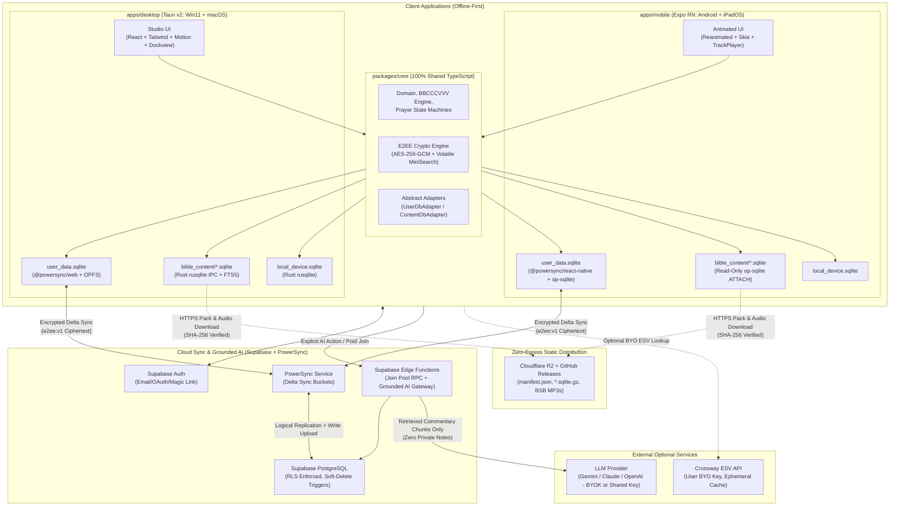

# B1: System Architecture Overview

**Document ID:** `B1`  
**Version:** `1.0.0`  
**Status:** `Approved`  
**Owner:** Founder / Architect  
**Last Updated:** `2026-11-24`  
**Related Docs:** `B2`, `B3`, `B4`, `B6`, `B8`, `C1`, `C2`

## Purpose & Scope

Provides the end-to-end system topology, runtime boundaries, offline-first data flows, and security zones connecting Client Apps, Local SQLite Engines, Cloudflare R2 Content CDN, Supabase/PowerSync Cloud, and the Grounded AI Gateway.

## Audience

Founder, AI coding partner, and DevOps/security reviewers.

## Body

### 4.1 High-Level System Topology

### 4.2 Architectural Principles & Trust Boundaries

1. **Local-First Read/Write Path (Zero Network on Hot Paths):**
   - Every UI render reads directly from local SQLite (`ContentDbAdapter` for Bible/exegesis; `UserDbAdapter` for highlights/notes/pools).
   - Writes commit immediately to local `user_data.sqlite` (updating UI optimistically in <16ms); PowerSync uploads queued mutations asynchronously when connectivity exists.
2. **Strict Data Plane Separation (Three Local Stores):**
   - **Plane A — Immutable Content (`bible_content/*.sqlite`):** Never written by the app; replaced atomically via `manifest.json` (`B4 §4.6`).
   - **Plane B — Synced User Graph (`user_data.sqlite`):** Synced via PowerSync; sensitive payloads encrypted *before* SQLite `INSERT`/`UPDATE` when E2EE is enabled (`ADR-004`).
   - **Plane C — Ephemeral Device State (`local_device.sqlite`):** Never synced (installed packs, scroll position, audio LRU cache, ESV ephemeral TTL cache).
3. **Zero-Knowledge Cloud Boundary:**
   - Plaintext of E2EE fields (`study_notes`, `prayer_item_user_states`, `prayer_session_logs`, `ink_canvases`) exists **only** inside client volatile RAM while the vault is unlocked.
   - Neither Supabase PostgreSQL, PowerSync, nor Edge Function logs ever receive the user's Vault Passphrase, Recovery Key, DEK, or decrypted personal notes.
4. **Enforceable AI Grounding Flow:**
   - Client invokes `POST /functions/v1/ai-synopsis` with `{ startVerseId, endVerseId, question, traditions[] }` (plus optional `X-BYOK-Key` pass-through header).
   - Edge Function retrieves strictly matching `commentary_chunks` (or client passes retrieved chunks from local `commentary_pd.sqlite` to keep server DB light!).
   - **[Architectural Optimization]:** Having the client retrieve `commentary_chunks` locally from `commentary_pd.sqlite` (exact passage overlap + local FTS5) and pass those chunk IDs + text to the stateless AI Gateway Edge Function eliminates server-side `pgvector` storage costs entirely while preserving 100% verifiable citations! (Detailed in `B2` and `C1`.)

### 4.3 Runtime Failure & Degradation Modes

| Dependency Unavailable | System Behavior | User Experience |
| --- | --- | --- |
| **Internet Offline** | PowerSync pauses; local SQLite serves all installed packs, FTS5, highlights, notes, Prayer Pools, offline prayer templates, cached audio. | Subtle offline badge; AI Smart Synopsis and uncached audio gracefully disabled with clear message. |
| **Supabase / PowerSync Outage** | Local reads/writes continue uninterrupted; PowerSync queues mutations locally with exponential backoff. | Zero data loss; sync resumes automatically when service returns. |
| **Cloudflare R2 Pack Download Interrupted** | Partial `.tmp` file kept for HTTP `Range` resume; corrupted files fail SHA-256 and are discarded. | Active installed packs remain completely untouched (`B4 §4.6`). |
| **E2EE Vault Locked** | Unencrypted metadata (verse refs, pool titles, `pray_count`) remains accessible; encrypted fields render a "Unlock Vault" prompt. | User can still read Bible & run Breath Prayer without unlocking personal journal. |

## Acceptance / Done Criteria

- Architecture diagram matches exact adapters in `B3`, schemas in `B4`, and security boundaries in `B6`.
- Every external call crosses a documented trust boundary with explicit offline degradation.

## Open Questions

- None.

## Assumptions

- `ASM-04` (`A7`): Static packs are pre-built offline by `tools/pack-builder` and never assembled on mobile devices.

## Change Log

- `1.0.0` | `2026-11-24` | Athena | Initial System Architecture Overview aligned to `B4` & `B8`.

## Traceability

- Upstream: `A1`, `A2`, `B8`. Downstream: `B2`, `B3`, `B6`, `C1`, `C2`, `E2`.
