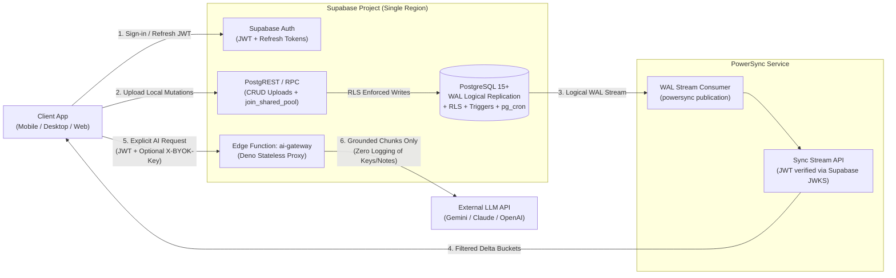

# B2: Backend, PowerSync & AI Gateway Architecture

**Document ID:** `B2`  
**Version:** `1.0.0`  
**Status:** `Approved`  
**Owner:** Founder / Architect  
**Last Updated:** `2026-11-24`  
**Related Docs:** `B1`, `B4`, `B6`, `B8` (`ADR-002`, `ADR-004`), `C1`, `C2`, `C4`

## Purpose & Scope

Defines the server-side architecture on **Supabase** (PostgreSQL, Auth, Edge Functions) and **PowerSync** (delta sync engine): logical replication setup, server-side soft-delete & timestamp triggers, tombstone garbage collection, and the stateless Grounded AI Gateway. Excludes RLS SQL (`C4`), sync bucket YAML (`C2`), and AI JSON payload schemas (`C1`).

## Audience

Developer and AI coding partner implementing `supabase/migrations/`, `supabase/functions/`, and PowerSync cloud configuration.

## Body

### 4.1 Backend Component Architecture



### 4.2 PostgreSQL Replication & Server-Side Triggers (`supabase/migrations/0002_triggers_and_powersync.sql`)

PowerSync requires a dedicated PostgreSQL publication (`powersync`) and a low-privilege replication role. In addition, server-side triggers guarantee **authoritative timestamps** (preventing client clock skew from breaking LWW) and **cascading soft deletes** (preventing orphaned children when a pool is tombstoned).

```sql
-- 1. PowerSync Logical Replication Publication (all 11 synced tables from B4 §4.3)
CREATE PUBLICATION powersync FOR TABLE
    public.user_profiles,
    public.highlights,
    public.study_notes,
    public.ink_canvases,
    public.prayer_pools,
    public.prayer_pool_members,
    public.prayer_pool_items,
    public.prayer_item_user_states,
    public.prayer_session_logs,
    public.reading_plan_enrollments,
    public.reading_progress;

-- 2. Authoritative Server Timestamp Trigger (mitigates client device clock skew)
CREATE OR REPLACE FUNCTION public.set_server_updated_at()
RETURNS TRIGGER LANGUAGE plpgsql AS $$
BEGIN
    NEW.updated_at := GREATEST(COALESCE(NEW.updated_at, now()), now());
    RETURN NEW;
END;
$$;

-- Apply to all 11 synced tables (shown for prayer_pools; apply identically to all 11 in migration)
CREATE TRIGGER trg_prayer_pools_updated_at
BEFORE UPDATE ON public.prayer_pools
FOR EACH ROW EXECUTE FUNCTION public.set_server_updated_at();

-- 3. Soft-Delete Cascade Trigger: When a prayer_pool is tombstoned, tombstone its items & memberships
CREATE OR REPLACE FUNCTION public.cascade_pool_soft_delete()
RETURNS TRIGGER LANGUAGE plpgsql SECURITY DEFINER SET search_path = public AS $$
BEGIN
    IF OLD.deleted_at IS NULL AND NEW.deleted_at IS NOT NULL THEN
        UPDATE public.prayer_pool_items
           SET deleted_at = NEW.deleted_at, updated_at = now()
         WHERE pool_id = NEW.id AND deleted_at IS NULL;

        UPDATE public.prayer_pool_members
           SET deleted_at = NEW.deleted_at, updated_at = now()
         WHERE pool_id = NEW.id AND deleted_at IS NULL;
        -- Note: prayer_item_user_states are intentionally NOT deleted so users retain personal answered testimonies.
    END IF;
    RETURN NEW;
END;
$$;

CREATE TRIGGER trg_cascade_pool_soft_delete
AFTER UPDATE OF deleted_at ON public.prayer_pools
FOR EACH ROW EXECUTE FUNCTION public.cascade_pool_soft_delete();

-- 4. Auto-Provision Owner Membership on Pool Creation
CREATE OR REPLACE FUNCTION public.add_pool_owner_member()
RETURNS TRIGGER LANGUAGE plpgsql SECURITY DEFINER SET search_path = public AS $$
BEGIN
    INSERT INTO public.prayer_pool_members (id, pool_id, user_id, role, joined_at, updated_at)
    VALUES (gen_random_uuid(), NEW.id, NEW.owner_user_id, 'OWNER', now(), now())
    ON CONFLICT (pool_id, user_id) DO NOTHING;
    RETURN NEW;
END;
$$;

CREATE TRIGGER trg_add_pool_owner_member
AFTER INSERT ON public.prayer_pools
FOR EACH ROW EXECUTE FUNCTION public.add_pool_owner_member();
```

### 4.3 Tombstone Retention & Garbage Collection (`pg_cron`)

- Soft-deleted rows (`deleted_at IS NOT NULL`) remain in PostgreSQL for **90 days** so offline devices returning within 3 months receive the tombstone cleanly.
- A weekly `pg_cron` job hard-deletes rows where `deleted_at < now() - interval '90 days'`.
- Any client offline >90 days triggers a PowerSync full re-sync checkpoint, pruning stale local rows safely.

### 4.4 Stateless Grounded AI Gateway Architecture (`supabase/functions/ai-gateway/`)

To honor `CON-01` (personal/church cost budget) and `FR-401` (enforceable grounding) without paying for managed vector databases:

1. **Local-First Retrieval:** On the client, `packages/core/src/ai/` queries local `commentary_pd.sqlite` for `commentary_chunks` overlapping `[startVerseId, endVerseId]` filtered by the user's selected `tradition_tags` (capped at top 12 chunks / ~6,000 tokens).
2. **Stateless Edge Proxy:** The client posts `{ mode: 'SYNOPSIS' | 'PRAYER_PROMPT', passageText, passageRef, chunks[], question }` to `ai-gateway` with a valid Supabase JWT.
3. **BYOK Pass-Through:** If the user supplies their own API key (`X-BYOK-Provider`, `X-BYOK-Key`), the Edge Function forwards the request directly to Gemini / Anthropic / OpenAI and **never logs, caches, or persists** the key or prompt body.
4. **Shared Quota Mode (Optional Church Key):** When using the app's default server key, an in-DB sliding counter (`ai_usage_daily` table, not synced) enforces a soft cap (default: **30 requests/user/day**) to prevent accidental billing spikes.
5. **Post-Generation Citation Verification:** Before returning HTTP 200, the Edge Function parses the LLM's structured JSON output and verifies that every cited `chunk_id` exists in the request's input `chunks[]` set—stripping or rejecting hallucinated IDs (`C1`).

## Acceptance / Done Criteria

- `supabase db reset` applies `0001_user_schema.sql`, `0002_triggers_and_powersync.sql`, and `0003_rls_and_rpcs.sql` with zero warnings.
- Soft-deleting a `prayer_pools` row automatically soft-deletes its `prayer_pool_items` and `prayer_pool_members` while preserving `prayer_item_user_states`.
- `ai-gateway` returns HTTP 401 on missing/invalid JWT and strips unknown `chunk_id` citations.

## Open Questions

- `[OPEN]` Confirm whether `pg_cron` is enabled on the chosen Supabase tier; if unavailable on free tier, run the 90-day purge via a monthly GitHub Actions cron calling a service-role Edge Function.

## Assumptions

- `ASM-02` (`A7`): Single-region Supabase instance (lowest latency to founder/church region) is sufficient for 1–250 users.

## Change Log

- `1.0.0` | `2026-11-24` | Athena | Initial Backend, PowerSync WAL/Triggers, and Stateless AI Gateway architecture.

## Traceability

- Upstream: `B1`, `B4`, `B8`. Downstream: `B6`, `C1`, `C2`, `C4`, `E1`, `E2`.
