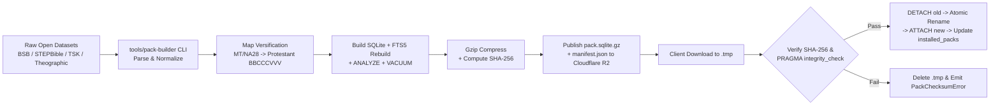

# B4: Data Architecture, Schemas & Content Pack ETL

**Document ID:** `B4`  
**Version:** `1.0.1`  
**Status:** `Approved (Gate 1 Baseline)`  
**Owner:** Founder / Architect  
**Last Updated:** `2026-11-25`  
**Related Docs:** `B8` (`ADR-002..005`), `B2`, `B6`, `C2`, `C4`, `G1`

## Purpose & Scope

Single source of truth for **all** local SQLite schemas (`bible_content` packs, `user_data` synced DB, `local_device` unsynced DB), Supabase PostgreSQL DDL, TypeScript domain/view contracts, versification mapping, and the Content Pack ETL + atomic update protocol.

Excludes PowerSync YAML bucket definitions and Supabase RLS policies (defined in `B2` / `C4`).

## Audience

Developer, AI coding partner, and ETL scripts. All SQL migrations, PowerSync schema definitions, and `packages/core` types must conform 1:1 to this document.

## Body

### 4.1 Canonical Addressing & Versification Rules

1. **Canonical Verse ID (`BBCCCVVV`)**: 32-bit integer using the **Protestant (KJV/BSB) 66-book versification**:
   - `canonical_verse_id = (book_number * 1_000_000) + (chapter * 1_000) + verse`
   - Bounds: `01001001` (Genesis 1:1) through `66022021` (Revelation 22:21).
   - Cross-chapter ranges use inclusive `[start_verse_id, end_verse_id]` (for example, Isaiah 52:13–53:12 = `23052013` to `23053012`).
   - Chapter-level queries use range index scans: `canonical_verse_id BETWEEN (BB*1000000 + CCC*1000) AND (BB*1000000 + CCC*1000 + 999)`.
2. **Versification Normalization (`versification_maps`)**:
   - Original-language datasets (for example, Hebrew Masoretic Text `hebrew_mt` in STEPBible TAHOT) differ from Protestant English numbering, notably Psalm superscriptions like Ps 51:1–2 MT → Ps 51:0/title + 51:1 Eng, Joel 3–4 MT → Joel 2:28–3:21 Eng, and Malachi 3:19–24 MT → Mal 4:1–6 Eng.
   - At ETL build time, every `interlinear_tokens` row stores **both** its original `source_verse_id` (MT/NA28) and its mapped Protestant `canonical_verse_id` via `versification_maps`, enabling O(log n) joins from any English translation without runtime remapping overhead.

### 4.2 Modular Static Content Pack Schemas (`bible_content/*.sqlite`)

Every content pack `.sqlite` file is opened `READONLY` and must include `pack_metadata`.

```sql
-- ============================================================================
-- COMMON HEADER (Present in EVERY content pack .sqlite file)
-- ============================================================================
PRAGMA foreign_keys = ON;

CREATE TABLE pack_metadata (
    pack_id TEXT PRIMARY KEY,          -- e.g. 'core_bsb', 'exegesis_step', 'study_refs'
    pack_type TEXT NOT NULL,           -- 'TRANSLATION' | 'EXEGESIS' | 'STUDY_REFS' | 'COMMENTARY'
    schema_version INTEGER NOT NULL,   -- Current: 1
    content_version TEXT NOT NULL,     -- SemVer e.g. '1.0.0'
    display_name TEXT NOT NULL,
    license_spdx TEXT NOT NULL,        -- e.g. 'CC0-1.0', 'CC-BY-4.0', 'CC-BY-SA-4.0'
    attribution_text TEXT NOT NULL,
    built_at TEXT NOT NULL             -- ISO-8601 UTC
);

-- ============================================================================
-- PACK TYPE 1: TRANSLATION PACK (e.g., core_bsb.sqlite, trans_web.sqlite)
-- ============================================================================
CREATE TABLE translations (
    translation_code TEXT PRIMARY KEY, -- 'BSB' | 'WEB' | 'KJV' | 'ASV' | 'NET'
    name TEXT NOT NULL,
    language TEXT NOT NULL DEFAULT 'en',
    license_type TEXT NOT NULL,
    versification TEXT NOT NULL DEFAULT 'protestant',
    has_audio INTEGER NOT NULL DEFAULT 0,
    has_word_alignments INTEGER NOT NULL DEFAULT 0,
    version TEXT NOT NULL
);

CREATE TABLE books (
    book_number INTEGER PRIMARY KEY,   -- 1..66
    osis_code TEXT NOT NULL UNIQUE,    -- 'Gen'..'Rev'
    name TEXT NOT NULL,                -- 'Genesis'..'Revelation'
    testament TEXT NOT NULL,           -- 'OT' | 'NT'
    chapter_count INTEGER NOT NULL,
    literary_genre TEXT NOT NULL       -- 'LAW' | 'HISTORY' | 'POETRY_WISDOM' | 'PROPHECY' | 'GOSPEL' | 'ACTS' | 'EPISTLE' | 'APOCALYPTIC'
);

CREATE TABLE verses (
    id INTEGER PRIMARY KEY AUTOINCREMENT,
    translation_code TEXT NOT NULL,
    canonical_verse_id INTEGER NOT NULL, -- BBCCCVVV
    book_number INTEGER NOT NULL,
    chapter INTEGER NOT NULL,
    verse INTEGER NOT NULL,
    plain_text TEXT NOT NULL,            -- Clean text for FTS5, copy, & prayer capture
    content_json TEXT NOT NULL,          -- JSON array of VerseSpan objects (see §4.5)
    CONSTRAINT unq_verse UNIQUE (translation_code, canonical_verse_id),
    FOREIGN KEY (translation_code) REFERENCES translations(translation_code) ON DELETE CASCADE,
    FOREIGN KEY (book_number) REFERENCES books(book_number)
);
CREATE INDEX idx_verses_bcv ON verses(translation_code, book_number, chapter, verse);
CREATE INDEX idx_verses_canonical ON verses(canonical_verse_id);

-- External-content FTS5 table populated at ETL build time via:
-- INSERT INTO verses_fts(verses_fts) VALUES('rebuild');
CREATE VIRTUAL TABLE verses_fts USING fts5(
    translation_code UNINDEXED,
    canonical_verse_id UNINDEXED,
    plain_text,
    content='verses',
    content_rowid='id',
    tokenize='unicode61 remove_diacritics 2'
);

CREATE TABLE footnotes (
    footnote_id TEXT PRIMARY KEY,        -- e.g. 'BSB:45008028:a'
    translation_code TEXT NOT NULL,
    canonical_verse_id INTEGER NOT NULL,
    marker TEXT NOT NULL,                -- 'a', '1', '*'
    category TEXT NOT NULL DEFAULT 'NOTE', -- 'TRANSLATION' | 'MANUSCRIPT' | 'CROSS_REF' | 'NOTE'
    body_text TEXT NOT NULL,
    FOREIGN KEY (translation_code) REFERENCES translations(translation_code) ON DELETE CASCADE
);
CREATE INDEX idx_footnotes_verse ON footnotes(translation_code, canonical_verse_id);

-- Word-to-Strong's / Interlinear alignment for tap-any-English-word lookups
CREATE TABLE verse_word_alignments (
    id INTEGER PRIMARY KEY AUTOINCREMENT,
    translation_code TEXT NOT NULL,
    canonical_verse_id INTEGER NOT NULL,
    span_index INTEGER NOT NULL,         -- Index into verses.content_json array
    char_start INTEGER NOT NULL,         -- UTF-16 offset within span.text
    char_end INTEGER NOT NULL,
    strongs_id TEXT,                     -- Fast lookup without attaching exegesis pack
    interlinear_word_pos INTEGER         -- Joins to interlinear_tokens.word_position
);
CREATE INDEX idx_align_verse ON verse_word_alignments(translation_code, canonical_verse_id);

-- Audio metadata & verse-level sync timestamps
CREATE TABLE audio_editions (
    edition_id TEXT PRIMARY KEY,         -- e.g. 'bsb_souer_single'
    translation_code TEXT NOT NULL,
    narrator_name TEXT NOT NULL,
    style TEXT NOT NULL,                 -- 'SINGLE_VOICE' | 'DRAMATIZED'
    base_url TEXT NOT NULL,              -- Cloudflare R2 prefix
    format TEXT NOT NULL DEFAULT 'mp3',
    FOREIGN KEY (translation_code) REFERENCES translations(translation_code)
);

CREATE TABLE audio_chapters (
    id INTEGER PRIMARY KEY AUTOINCREMENT,
    edition_id TEXT NOT NULL,
    book_number INTEGER NOT NULL,
    chapter INTEGER NOT NULL,
    relative_path TEXT NOT NULL,         -- e.g. '45/45_008.mp3'
    duration_ms INTEGER NOT NULL,
    file_size_bytes INTEGER NOT NULL,
    sha256 TEXT,
    CONSTRAINT unq_audio_ch UNIQUE (edition_id, book_number, chapter),
    FOREIGN KEY (edition_id) REFERENCES audio_editions(edition_id) ON DELETE CASCADE
);

CREATE TABLE audio_verse_timestamps (
    edition_id TEXT NOT NULL,
    canonical_verse_id INTEGER NOT NULL,
    start_ms INTEGER NOT NULL,
    end_ms INTEGER NOT NULL,
    PRIMARY KEY (edition_id, canonical_verse_id),
    FOREIGN KEY (edition_id) REFERENCES audio_editions(edition_id) ON DELETE CASCADE
);
CREATE INDEX idx_audio_ts_lookup ON audio_verse_timestamps(edition_id, start_ms);

-- ============================================================================
-- PACK TYPE 2: EXEGESIS PACK (exegesis_step.sqlite)
-- ============================================================================
CREATE TABLE versification_maps (
    source_versification TEXT NOT NULL,  -- 'hebrew_mt' | 'lxx' | 'na28'
    source_verse_id INTEGER NOT NULL,
    canonical_verse_id INTEGER NOT NULL, -- Protestant BBCCCVVV
    mapping_type TEXT NOT NULL DEFAULT 'EXACT', -- 'EXACT' | 'OFFSET' | 'SPLIT' | 'MERGE'
    PRIMARY KEY (source_versification, source_verse_id, canonical_verse_id)
);
CREATE INDEX idx_vmap_canonical ON versification_maps(canonical_verse_id);

CREATE TABLE interlinear_tokens (
    token_id INTEGER PRIMARY KEY AUTOINCREMENT,
    canonical_verse_id INTEGER NOT NULL, -- Mapped Protestant BBCCCVVV
    source_verse_id INTEGER NOT NULL,    -- Original MT/NA28 BBCCCVVV
    word_position INTEGER NOT NULL,      -- 1-based sequence within canonical_verse_id
    original_word TEXT NOT NULL,         -- Pointed Hebrew/Aramaic or Polytonic Greek
    transliteration TEXT,
    english_gloss TEXT,
    strongs_id TEXT,                     -- Normalized e.g. 'G0026' or 'G26' (canonical: unpadded 'G26', 'H430')
    lemma TEXT,
    morphology_code TEXT,                -- STEPBible Robinsons / OSHM code
    morphology_human TEXT,               -- Pre-expanded e.g. 'Verb - Aorist Active Indicative - 3rd Person Singular'
    CONSTRAINT unq_token UNIQUE (canonical_verse_id, word_position)
);
CREATE INDEX idx_tokens_verse ON interlinear_tokens(canonical_verse_id);
CREATE INDEX idx_tokens_strongs ON interlinear_tokens(strongs_id);
CREATE INDEX idx_tokens_lemma ON interlinear_tokens(lemma);

CREATE TABLE lexicon_entries (
    strongs_id TEXT PRIMARY KEY,         -- Unpadded canonical: 'G26', 'H430'
    language TEXT NOT NULL,              -- 'hebrew' | 'aramaic' | 'greek'
    lemma TEXT NOT NULL,
    transliteration TEXT,
    pronunciation TEXT,
    short_definition TEXT NOT NULL,
    full_entry_json TEXT NOT NULL,       -- Structured BDB / Thayer / Abbott-Smith sections
    ot_occurrences INTEGER NOT NULL DEFAULT 0,
    nt_occurrences INTEGER NOT NULL DEFAULT 0,
    total_occurrences INTEGER NOT NULL DEFAULT 0
);

-- ============================================================================
-- PACK TYPE 3: STUDY REFERENCES PACK (study_refs.sqlite)
-- ============================================================================
CREATE TABLE cross_references (
    id INTEGER PRIMARY KEY AUTOINCREMENT,
    from_verse_id INTEGER NOT NULL,
    to_start_verse_id INTEGER NOT NULL,
    to_end_verse_id INTEGER NOT NULL,
    votes INTEGER NOT NULL DEFAULT 0,
    source TEXT NOT NULL DEFAULT 'TSK'
);
CREATE INDEX idx_xref_from ON cross_references(from_verse_id, votes DESC);

CREATE TABLE factbook_entities (
    entity_id TEXT PRIMARY KEY,          -- Theographic slug e.g. 'person:paul_1', 'place:ephesus'
    entity_type TEXT NOT NULL,           -- 'person' | 'place' | 'event' | 'topic'
    name TEXT NOT NULL,
    aliases_json TEXT NOT NULL DEFAULT '[]',
    summary TEXT NOT NULL,
    latitude REAL,
    longitude REAL,
    era_label TEXT,
    metadata_json TEXT NOT NULL          -- Relationships, timeline dates, dictionary refs
);
CREATE INDEX idx_factbook_type_name ON factbook_entities(entity_type, name);

CREATE TABLE factbook_verse_links (
    entity_id TEXT NOT NULL,
    canonical_verse_id INTEGER NOT NULL,
    PRIMARY KEY (entity_id, canonical_verse_id),
    FOREIGN KEY (entity_id) REFERENCES factbook_entities(entity_id) ON DELETE CASCADE
);
CREATE INDEX idx_factbook_verse ON factbook_verse_links(canonical_verse_id);

CREATE TABLE reading_plans (
    plan_id TEXT PRIMARY KEY,            -- e.g. 'plan_manna_gospels_90', 'plan_mcheyne_365'
    title TEXT NOT NULL,
    description TEXT NOT NULL,
    total_days INTEGER NOT NULL,
    category TEXT NOT NULL,              -- 'WHOLE_BIBLE' | 'NEW_TESTAMENT' | 'PSALMS_PROVERBS' | 'TOPICAL'
    recommended_manna_mode INTEGER NOT NULL DEFAULT 1
);

CREATE TABLE reading_plan_days (
    id INTEGER PRIMARY KEY AUTOINCREMENT,
    plan_id TEXT NOT NULL,
    day_number INTEGER NOT NULL,
    sequence_order INTEGER NOT NULL DEFAULT 1, -- Supports multiple readings per day
    start_verse_id INTEGER NOT NULL,
    end_verse_id INTEGER NOT NULL,
    label TEXT NOT NULL,                       -- e.g. 'Psalm 23', 'Romans 8:1-17'
    FOREIGN KEY (plan_id) REFERENCES reading_plans(plan_id) ON DELETE CASCADE
);
CREATE INDEX idx_plan_days ON reading_plan_days(plan_id, day_number, sequence_order);

-- ============================================================================
-- PACK TYPE 4: PUBLIC-DOMAIN COMMENTARY PACK (commentary_pd.sqlite - Phase 3/4)
-- ============================================================================
CREATE TABLE commentary_sources (
    source_id TEXT PRIMARY KEY,          -- e.g. 'net_notes', 'jfb', 'keil_delitzsch', 'calvin', 'henry'
    title TEXT NOT NULL,
    author TEXT NOT NULL,
    year_published INTEGER,
    tradition_tags_json TEXT NOT NULL,   -- e.g. '["HISTORICAL_GRAMMATICAL","REFORMED"]'
    license_spdx TEXT NOT NULL
);

CREATE TABLE commentary_chunks (
    chunk_id TEXT PRIMARY KEY,           -- e.g. 'jfb:45008028:01' (cited directly by AI RAG)
    source_id TEXT NOT NULL,
    start_verse_id INTEGER NOT NULL,
    end_verse_id INTEGER NOT NULL,
    citation_label TEXT NOT NULL,        -- e.g. 'Jamieson-Fausset-Brown on Rom 8:28'
    body_text TEXT NOT NULL,
    FOREIGN KEY (source_id) REFERENCES commentary_sources(source_id) ON DELETE CASCADE
);
CREATE INDEX idx_commentary_range ON commentary_chunks(start_verse_id, end_verse_id);
```

### 4.3 Synced User Database Schema (`user_data.sqlite` ↔ Supabase PostgreSQL)

> **PowerSync Alignment Rules:**
> 1. Every synced table uses **`id`** (`TEXT PRIMARY KEY` in SQLite, `uuid PRIMARY KEY` in PostgreSQL).
> 2. Timestamps are stored as ISO-8601 UTC strings in SQLite (`TEXT`) and `timestamptz` in PostgreSQL.
> 3. **No `ON DELETE CASCADE` reliance for soft deletes:** Deleting a parent (`prayer_pools`) sets `deleted_at = NOW()` inside a repository transaction that also tombstones child rows (and a Supabase Postgres trigger mirrors this safeguard server-side).
> 4. **Shared Pool Privacy Split:** `prayer_pool_items` holds **only** the verse range and optional leader prompt; every user's personal notes, prayer count, rotation timestamp, and answered testimony live exclusively in `prayer_item_user_states`.

```sql
-- ============================================================================
-- SUPABASE POSTGRESQL AUTHORITATIVE DDL (PowerSync Mirror Target)
-- Note: In PowerSync client SQLite, uuid -> TEXT, timestamptz -> TEXT, boolean -> INTEGER (0/1)
-- ============================================================================

CREATE TABLE user_profiles (
    id uuid PRIMARY KEY,                 -- Matches auth.users.id (or local UUID in offline guest mode)
    display_name text,
    default_translation text NOT NULL DEFAULT 'BSB',
    manna_pacing_enabled boolean NOT NULL DEFAULT false,
    e2ee_enabled boolean NOT NULL DEFAULT false,
    e2ee_key_version integer NOT NULL DEFAULT 1,
    e2ee_kdf_algo text,                  -- 'PBKDF2-SHA256-600K'
    e2ee_salt_b64 text,
    e2ee_wrapped_dek_passphrase text,    -- AES-GCM wrapped DEK using passphrase KEK
    e2ee_wrapped_dek_recovery text,      -- AES-GCM wrapped DEK using recovery key KEK
    created_at timestamptz NOT NULL DEFAULT now(),
    updated_at timestamptz NOT NULL DEFAULT now(),
    deleted_at timestamptz
);

CREATE TABLE highlights (
    id uuid PRIMARY KEY,
    user_id uuid NOT NULL,
    translation_code text NOT NULL,
    start_verse_id integer NOT NULL,
    end_verse_id integer NOT NULL,
    start_offset integer,
    end_offset integer,
    color_hex text NOT NULL,
    symbol_tag text,                     -- 'KEY_TERM' | 'GOD_REF' | 'TRANSITION' | 'PROMISE' | 'COMMAND' | NULL
    created_at timestamptz NOT NULL DEFAULT now(),
    updated_at timestamptz NOT NULL DEFAULT now(),
    deleted_at timestamptz
);
CREATE INDEX idx_highlights_user_range ON highlights(user_id, start_verse_id, end_verse_id) WHERE deleted_at IS NULL;

CREATE TABLE study_notes (
    id uuid PRIMARY KEY,
    user_id uuid NOT NULL,
    start_verse_id integer NOT NULL,
    end_verse_id integer NOT NULL,
    note_type text NOT NULL DEFAULT 'GENERAL', -- 'GENERAL' | 'INDUCTIVE_5WH' | 'PARAPHRASE' | 'APPLICATION'
    title_payload text,                  -- Plaintext or e2ee:v1:... envelope
    body_payload text NOT NULL,          -- Plaintext JSON/Markdown or e2ee:v1:... envelope
    is_encrypted boolean NOT NULL DEFAULT false,
    checkup_remind_at timestamptz,       -- For Inductive Application Step 5 (Checkup)
    created_at timestamptz NOT NULL DEFAULT now(),
    updated_at timestamptz NOT NULL DEFAULT now(),
    deleted_at timestamptz
);
CREATE INDEX idx_notes_user_range ON study_notes(user_id, start_verse_id, end_verse_id) WHERE deleted_at IS NULL;

CREATE TABLE ink_canvases (
    id uuid PRIMARY KEY,
    user_id uuid NOT NULL,
    note_id uuid,                        -- Optional parent study_note.id
    canonical_verse_id integer NOT NULL, -- Primary anchor verse
    strokes_payload text NOT NULL,       -- Portable JSON strokes (normalized 0..1000) or e2ee:v1:...
    is_encrypted boolean NOT NULL DEFAULT false,
    created_at timestamptz NOT NULL DEFAULT now(),
    updated_at timestamptz NOT NULL DEFAULT now(),
    deleted_at timestamptz
);
CREATE INDEX idx_ink_user_verse ON ink_canvases(user_id, canonical_verse_id) WHERE deleted_at IS NULL;

-- Forward-thinking Shared & Private Prayer Pools
CREATE TABLE prayer_pools (
    id uuid PRIMARY KEY,
    owner_user_id uuid NOT NULL,
    title text NOT NULL,
    description text,
    category text NOT NULL,              -- 'ANXIETY' | 'GUIDANCE' | 'THANKSGIVING' | 'FAMILY' | 'FINANCE' | 'HEALING' | 'CUSTOM'
    color_hex text NOT NULL DEFAULT '#3B82F6',
    visibility text NOT NULL DEFAULT 'PRIVATE', -- 'PRIVATE' | 'SHARED'
    share_code text UNIQUE,              -- 8-char Crockford Base32 code when visibility = 'SHARED'
    allow_member_contributions boolean NOT NULL DEFAULT false, -- False = Leader-Curated (v1 default); True = Collaborative
    created_at timestamptz NOT NULL DEFAULT now(),
    updated_at timestamptz NOT NULL DEFAULT now(),
    deleted_at timestamptz
);
CREATE INDEX idx_pools_owner ON prayer_pools(owner_user_id) WHERE deleted_at IS NULL;

CREATE TABLE prayer_pool_members (
    id uuid PRIMARY KEY,
    pool_id uuid NOT NULL,
    user_id uuid NOT NULL,
    role text NOT NULL DEFAULT 'MEMBER', -- 'OWNER' | 'LEADER' | 'MEMBER'
    joined_at timestamptz NOT NULL DEFAULT now(),
    updated_at timestamptz NOT NULL DEFAULT now(),
    deleted_at timestamptz,
    CONSTRAINT unq_pool_member UNIQUE (pool_id, user_id)
);
CREATE INDEX idx_pool_members_user ON prayer_pool_members(user_id) WHERE deleted_at IS NULL;

-- Pool Items: Strictly SHARED/CANONICAL passage content (no private user notes/counts!)
CREATE TABLE prayer_pool_items (
    id uuid PRIMARY KEY,
    pool_id uuid NOT NULL,
    created_by_user_id uuid NOT NULL,
    start_verse_id integer NOT NULL,
    end_verse_id integer NOT NULL,
    translation_code text NOT NULL,
    captured_text text NOT NULL,
    shared_prompt_text text,             -- Optional leader prayer prompt for church pool
    created_at timestamptz NOT NULL DEFAULT now(),
    updated_at timestamptz NOT NULL DEFAULT now(),
    deleted_at timestamptz
);
CREATE INDEX idx_pool_items_pool ON prayer_pool_items(pool_id) WHERE deleted_at IS NULL;

-- Per-User Private State for ANY Prayer Pool Item (Private OR Shared Pools)
CREATE TABLE prayer_item_user_states (
    id uuid PRIMARY KEY,
    item_id uuid NOT NULL,
    pool_id uuid NOT NULL,               -- Denormalized for fast PowerSync bucket filtering & rotation queries
    user_id uuid NOT NULL,
    user_notes_payload text,             -- Plaintext or e2ee:v1:...
    generated_prayer_prompt text,        -- User's personal AI/template prayer
    is_encrypted boolean NOT NULL DEFAULT false,
    pray_count integer NOT NULL DEFAULT 0,
    last_prayed_at timestamptz,          -- Drives Smart Session Rotation (ORDER BY last_prayed_at ASC NULLS FIRST)
    answered_at timestamptz,
    testimony_payload text,              -- Plaintext or e2ee:v1:...
    is_archived boolean NOT NULL DEFAULT false,
    created_at timestamptz NOT NULL DEFAULT now(),
    updated_at timestamptz NOT NULL DEFAULT now(),
    deleted_at timestamptz,
    CONSTRAINT unq_item_user_state UNIQUE (item_id, user_id)
);
CREATE INDEX idx_item_state_rotation ON prayer_item_user_states(user_id, pool_id, is_archived, last_prayed_at) WHERE deleted_at IS NULL;

CREATE TABLE prayer_session_logs (
    id uuid PRIMARY KEY,
    user_id uuid NOT NULL,
    pool_id uuid,
    item_id uuid,
    framework text NOT NULL,             -- 'LECTIO_DIVINA' | 'THREE_RS' | 'ACTS' | 'BREATH' | 'DECK'
    duration_seconds integer NOT NULL DEFAULT 0,
    journal_payload text,                -- Plaintext or e2ee:v1:...
    is_encrypted boolean NOT NULL DEFAULT false,
    completed_at timestamptz NOT NULL,
    created_at timestamptz NOT NULL DEFAULT now(),
    updated_at timestamptz NOT NULL DEFAULT now(),
    deleted_at timestamptz
);
CREATE INDEX idx_sessions_user_time ON prayer_session_logs(user_id, completed_at DESC) WHERE deleted_at IS NULL;

CREATE TABLE reading_plan_enrollments (
    id uuid PRIMARY KEY,
    user_id uuid NOT NULL,
    plan_id text NOT NULL,               -- References study_refs.reading_plans.plan_id
    started_at timestamptz NOT NULL,
    manna_locked boolean NOT NULL DEFAULT true,
    is_active boolean NOT NULL DEFAULT true,
    created_at timestamptz NOT NULL DEFAULT now(),
    updated_at timestamptz NOT NULL DEFAULT now(),
    deleted_at timestamptz
);

CREATE TABLE reading_progress (
    id uuid PRIMARY KEY,
    user_id uuid NOT NULL,
    enrollment_id uuid NOT NULL,
    plan_id text NOT NULL,
    day_number integer NOT NULL,
    completed_at timestamptz,
    created_at timestamptz NOT NULL DEFAULT now(),
    updated_at timestamptz NOT NULL DEFAULT now(),
    deleted_at timestamptz,
    CONSTRAINT unq_reading_day UNIQUE (enrollment_id, day_number)
);
```

> **Client mirror:** the app-created SQLite form of these tables (`uuid` → `TEXT`, `timestamptz` → `TEXT`, `boolean` → `INTEGER` 0/1, ISO-8601 defaults) is frozen as `USER_DATA_DDL` in `packages/core/src/content/user-data-schema.ts` (`USER_DATA_SCHEMA_VERSION = 1`). The study_refs pack DDL (§4.2 pack type 3) is frozen as `STUDY_REFS_PACK_DDL` in `packages/core/src/content/pack-schema.ts`.

### 4.4 Local-Only Device Database (`local_device.sqlite`, Never Synced)

```sql
CREATE TABLE installed_packs (
    pack_id TEXT PRIMARY KEY,
    pack_type TEXT NOT NULL,
    content_version TEXT NOT NULL,
    schema_version INTEGER NOT NULL,
    file_path TEXT NOT NULL,
    sha256 TEXT NOT NULL,
    file_size_bytes INTEGER NOT NULL,
    installed_at TEXT NOT NULL
);

CREATE TABLE audio_cache_entries (
    cache_key TEXT PRIMARY KEY,          -- '<edition_id>:<book>:<chapter>'
    file_path TEXT NOT NULL,
    file_size_bytes INTEGER NOT NULL,
    is_pinned INTEGER NOT NULL DEFAULT 0,-- 1 if user explicitly downloaded book
    last_accessed_at TEXT NOT NULL
);

CREATE TABLE api_ephemeral_cache (
    cache_key TEXT PRIMARY KEY,          -- e.g. 'esv:45008' (strictly respects Crossway TTL & 500-verse cap)
    payload_json TEXT NOT NULL,
    verse_count INTEGER NOT NULL DEFAULT 0,
    expires_at TEXT NOT NULL
);

CREATE TABLE workspace_state (
    key TEXT PRIMARY KEY,                -- 'last_passage', 'open_tabs', 'ambient_mixer_levels'
    value_json TEXT NOT NULL,
    updated_at TEXT NOT NULL
);
```

### 4.5 Canonical TypeScript Domain & View Contracts (`packages/core/src/domain/types.ts`)

```typescript
export type PackType = 'TRANSLATION' | 'EXEGESIS' | 'STUDY_REFS' | 'COMMENTARY';

export type PrayerCategory =
  | 'ANXIETY'
  | 'GUIDANCE'
  | 'THANKSGIVING'
  | 'FAMILY'
  | 'FINANCE'
  | 'HEALING'
  | 'CUSTOM';

export type PrayerFramework = 'LECTIO_DIVINA' | 'THREE_RS' | 'ACTS' | 'BREATH' | 'DECK';
export type PoolVisibility = 'PRIVATE' | 'SHARED';
export type PoolRole = 'OWNER' | 'LEADER' | 'MEMBER';
export type NoteType = 'GENERAL' | 'INDUCTIVE_5WH' | 'PARAPHRASE' | 'APPLICATION';
export type SymbolTag = 'KEY_TERM' | 'GOD_REF' | 'TRANSITION' | 'PROMISE' | 'COMMAND';

/** Structured span inside verses.content_json */
export interface VerseSpan {
  type: 'text' | 'heading' | 'poetry' | 'red_letter' | 'footnote' | 'paragraph_break';
  text: string;
  indentLevel?: number;
  footnoteId?: string;
}

export interface Verse {
  translationCode: string;
  canonicalVerseId: number; // BBCCCVVV
  bookNumber: number;
  chapter: number;
  verse: number;
  plainText: string;
  spans: VerseSpan[];
}

export interface InkStrokePoint {
  x: number;        // Normalized 0..1000
  y: number;        // Normalized 0..1000
  pressure: number; // 0..1
  t: number;        // Relative ms from stroke start
}

export interface InkStroke {
  id: string;
  colorHex: string;
  width: number;    // Normalized 1..20
  points: InkStrokePoint[];
}

/** Persisted Prayer Pool record (1:1 with prayer_pools table) */
export interface PrayerPoolRecord {
  id: string;
  ownerUserId: string;
  title: string;
  description?: string;
  category: PrayerCategory;
  colorHex: string;
  visibility: PoolVisibility;
  shareCode?: string;
  allowMemberContributions: boolean;
  createdAt: string;
  updatedAt: string;
  deletedAt?: string;
}

/** Derived Read-Model for UI (never persisted directly) */
export interface PrayerPoolView extends PrayerPoolRecord {
  userRole: PoolRole;
  activeItemsCount: number;
  answeredItemsCount: number;
  memberCount: number;
}

/** Derived Read-Model joining prayer_pool_items + prayer_item_user_states (decrypted in-memory) */
export interface PrayerPoolItemView {
  itemId: string;
  poolId: string;
  stateId?: string;          // Created lazily on first user interaction in shared pools
  createdByUserId: string;
  startVerseId: number;
  endVerseId: number;
  passageReference: string;  // Derived via formatCanonicalRange()
  translationCode: string;
  capturedText: string;
  sharedPromptText?: string;
  userNotes?: string;        // Decrypted in-memory
  generatedPrayerPrompt?: string;
  isEncrypted: boolean;
  prayCount: number;
  lastPrayedAt?: string;
  answeredAt?: string;
  testimony?: string;        // Decrypted in-memory
  isArchived: boolean;
  createdAt: string;
  updatedAt: string;
}

export type ReadingPlanCategory =
  | 'WHOLE_BIBLE'
  | 'NEW_TESTAMENT'
  | 'PSALMS_PROVERBS'
  | 'TOPICAL';

/** Static plan definition from the `study_refs` pack (§4.2 `reading_plans`). */
export interface ReadingPlan {
  planId: string;
  title: string;
  description: string;
  totalDays: number;
  category: ReadingPlanCategory;
  recommendedMannaMode: boolean;
}

/** One day's passage(s) from the `study_refs` pack (§4.2 `reading_plan_days`). */
export interface ReadingPlanDay {
  id: number;
  planId: string;
  dayNumber: number;
  sequenceOrder: number;
  startVerseId: number;
  endVerseId: number;
  label: string;
}

/** Synced enrollment in `user_data.sqlite` (§4.3 `reading_plan_enrollments`). */
export interface ReadingPlanEnrollment {
  id: string;
  userId: string;
  planId: string;
  startedAt: string;
  mannaLocked: boolean;
  isActive: boolean;
  createdAt: string;
  updatedAt: string;
  deletedAt?: string;
}

/** Synced per-day completion in `user_data.sqlite` (§4.3 `reading_progress`). */
export interface ReadingProgress {
  id: string;
  userId: string;
  enrollmentId: string;
  planId: string;
  dayNumber: number;
  completedAt?: string;
  createdAt: string;
  updatedAt: string;
  deletedAt?: string;
}
```

### 4.6 Content Pack ETL & Atomic Client Update Protocol



**Manifest Contract (`manifest.json` hosted on R2):**

```json
{
  "manifestVersion": 1,
  "generatedAt": "2026-11-24T18:00:00Z",
  "packs": [
    {
      "packId": "core_bsb",
      "packType": "TRANSLATION",
      "contentVersion": "1.0.0",
      "schemaVersion": 1,
      "minAppVersion": "0.1.0",
      "downloadUrl": "https://packs.breathandword.app/v1/core_bsb-1.0.0.sqlite.gz",
      "compressedBytes": 9437184,
      "uncompressedBytes": 28311552,
      "sha256Compressed": "<64-hex-chars>",
      "sha256Uncompressed": "<64-hex-chars>",
      "licenseSpdx": "CC0-1.0"
    }
  ]
}
```

## Acceptance / Done Criteria

- Every SQLite DDL block parses cleanly under SQLite 3.45+ with FTS5 enabled.
- Every PostgreSQL DDL block applies cleanly via `supabase db reset`.
- Zero drift between `prayer_pools` / `prayer_pool_items` / `prayer_item_user_states` tables and `packages/core` TypeScript interfaces.
- `tools/pack-builder` produces a passing `core_bsb.sqlite` verified by `PRAGMA integrity_check` and returning Romans 8:28 (`45008028`) via FTS5 in <15ms.

## Open Questions

- `[OPEN]` Exact BSB verse-level audio timestamp format (verify whether BSB provides JSON/VTT cue sheets or requires Aeneas/Whisper forced alignment during ETL—tracked in `B5`).

## Assumptions

- `[ASSUMPTION]` Unpadded Strong's IDs (`G26`, `H430`) are used canonically everywhere; ETL strips leading zeros (`G0026` → `G26`).
- `[ASSUMPTION]` Soft-deleted tombstones are purged server-side after 90 days via a scheduled Postgres job (safe offline grace window, detailed in `B2`).

## Change Log

- `1.0.0` | `2026-11-24` | Athena | Complete Gate-1 production schema resolving all 6 audit blockers (PowerSync `id` PKs, shared pool privacy split, versification maps, footnotes, audio timestamps, word alignments, reading plans, local device cache, ETL manifest).

## Traceability

- Upstream: `SPECIFICATION.md`, `A7`, `B8` (`ADR-002..005`). Downstream: `B2` (PowerSync buckets & RLS), `B3` (Monorepo repositories), `B5` (Licensing & ETL sources), `F1` (DB & crypto test suite).
