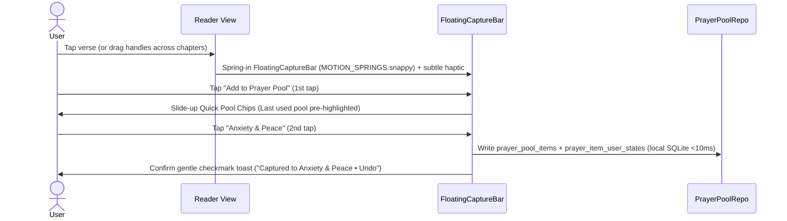

# D3: Adaptive UX Flows, Wireframes & WCAG 2.2 Accessibility

**Document ID:** `D3`  
**Version:** `1.0.0`  
**Status:** `Approved`  
**Owner:** Founder / Design  
**Last Updated:** `2026-11-24`  
**Related Docs:** `A1`, `A2`, `B3`, `B7`, `C3`, `D1`, `F1`

## Purpose & Scope

Maps adaptive layouts across **Android Phone**, **iPadOS Split-Screen (Apple Pencil)**, and **Desktop Studio (`dockview`)**, details the core animated user journeys (Tap-to-Capture, Smart Rotation Deck, 4 Guided Prayer Engines, Inductive + Ink), and enforces WCAG 2.2 AA accessibility standards.

## Audience

Developer and AI coding partner building `apps/mobile/app/` and `apps/desktop/src/`.

## Body

### 4.1 Adaptive Device Wireframes

```text
[1. ANDROID PHONE (<768px) — Thumb-First Reader]
+----------------------------------+
| Romans 8 [BSB v]   [Search] [●]  |  <- 2-tap switcher + Focus Mode dot
+----------------------------------+
|  28 And we know that God works   |
|  all things together for the     |  <- Tapping word opens Strong's sheet
|  good of those who love Him...   |  <- Selecting verse spawns Spring Bar:
|  +----------------------------+  |
|  | [Pray +] [Mark] [Note] [⑂] |  |  <- FloatingCaptureBar (1-tap to Pool)
|  +----------------------------+  |
+----------------------------------+
| [▶ Rom 8  1.0x | 🌧 Rain 30%]    |  <- Collapsible Dual-Track Mini Player
+----------------------------------+
|  [Read]  [Pray]  [Study]  [Lib]  |  <- 4-tab bottom navigation
+----------------------------------+

[2. iPadOS TABLET (≥768px) — Dual-Pane Study & Apple Pencil Desk]
+--------------------------------+-----------------------------------+
| Romans 8 [BSB v] [Compare +]   | [Study Notes] [Exegesis] [Pools]  |
+--------------------------------+-----------------------------------+
| 28 And we know that God works  | Note: Romans 8:28-30 [🔒 E2EE]    |
| all things together...         | [5Ws+H] [Paraphrase] [Apply] [✏] |
|                                | +-------------------------------+ |
| (Long-press & drag verse  ===> | |  Skia Apple Pencil Ink Canvas | |
|  directly into Prayer Pool!)   | |  [Pen] [Highlighter] [Undo]   | |
|                                | +-------------------------------+ |
+--------------------------------+-----------------------------------+

[3. DESKTOP STUDIO (Win11 / macOS — Dockview Multi-Pane + Cmd/Ctrl+K)]
+------------+---------------------------+---------------------------+
| LIBRARY    | [BSB: Rom 8] [ESV: Rom 8] | EXEGETICAL GUIDE (Rom 8)  |
| - Plans    | 28 And we know...  | 28.. | • Interlinear (G26 agapē) |
| - Pools    | 29 For those...    | 29.. | • TSK Cross-Refs (Top 10) |
|   • Peace  | (Synchronized Scroll)     | • Factbook: Paul, Rome    |
|   • Church +---------------------------+---------------------------+
|     [Shared| PRAYER JOURNAL & GROUNDED AI SYNOPSIS                 |
|      Code] | [Tradition: Historical-Grammatical v]  [Cite: JFB #1] |
+------------+-------------------------------------------------------+
```

### 4.2 Signature Animated User Flows

#### Flow A: Zero-Friction Tap-to-Capture (`FR-201`)



#### Flow B: 5-Minute Smart Rotation Deck & Answered Testimony (`FR-203`)

1. User taps **"Pray 5 Min"** on any Private or Shared Pool → `PrayerPoolRepo` fetches 3–5 unarchived items ordered by `last_prayed_at ASC NULLS FIRST`.
2. Enters **Sanctuary Ambient** theme (`D1`) with subtle cross-fade; renders swipeable card stack (`SwipePrayerDeck`):
   - **Front of Card:** Canonical reference, generous 22px serif verse text, subtle button to expand surrounding chapter, optional leader `shared_prompt_text`.
   - **Flip / Expand Drawer:** Offline Prayer Template (or opt-in AI Prayer Prompt), E2EE personal reflection input, and one-tap **"Mark Answered & Record Testimony"**.
3. Swiping right ("Amen / Prayed") triggers soft haptic pulse, increments `pray_count`, updates `last_prayed_at`, and glides next card forward (`MOTION_SPRINGS.gentle`).
4. Final card shows calm summary (*"4 Scriptures prayed • 4m 38s"*) and writes `prayer_session_logs`.

#### Flow C: Four Guided Prayer Engines (`FR-205`)

| Engine | Visual Stage Flow & Micro-Interactions |
| --- | --- |
| **120Hz Breath Prayer** | Full-screen Sanctuary canvas; concentric Skia glow ring expands smoothly on **Inhale (2–4s)** displaying top phrase (*"Be still and know..."*), pauses `400ms` with gentle haptic tap, contracts on **Exhale (4–6s)** displaying bottom phrase (*"...that You are God."*). Optional ambient rain/pad mixer. |
| **Lectio Divina** | 4-dot subtle progress header: **1. Lectio** (slow read, tap counter 1–3×) → **2. Meditatio** (tap a phrase in the verse to spotlight & isolate it with blur backdrop) → **3. Oratio** (calm E2EE journal sheet) → **4. Contemplatio** (1–3 min circular silence timer ending with soft singing-bowl chime). |
| **The 3 R's** | Horizontal 3-card paged flow anchored by pinned verse banner at top: **Rejoice** (God's character/promise) → **Repent** (private E2EE confession) → **Request** (grace to obey). |
| **ACTS Model** | 4-stage vertical/card flow (**Adoration → Confession → Thanksgiving → Supplication**) with Scripture-grounded starter prompts and encrypted journal persistence. |

### 4.3 WCAG 2.2 AA Accessibility Standards

| Requirement | Concrete Implementation Rule |
| --- | --- |
| **Reduced Motion (`2.3.3`)** | Respect `AccessibilityInfo.isReduceMotionEnabled()` (Mobile) and `@media (prefers-reduced-motion: reduce)` (Desktop/Web). In Breath Prayer, replace ring scaling with a gentle static progress bar + text opacity fade; replace springs with instant 150ms cross-fades. |
| **Dynamic Type & Reflow (`1.4.4`, `1.4.10`)** | Support OS font scaling up to **200%** without horizontal scrolling or button clipping; `FloatingCaptureBar` wraps cleanly to 2 rows if needed. |
| **Screen Reader Semantics (`1.3.1`, `4.1.2`)** | Label verse rows as `"Romans chapter 8, verse 28: And we know..."` (never read bare `"28"` inline); expose `accessibilityRole="button"` and `accessibilityHint` on every footnote, Strong's word, and prayer control. |
| **Target Sizes (`2.5.8`)** | Minimum interactive touch target **`44×44 pt`** on iPadOS/Android (`36×36 px` desktop) for toolbar icons, verse action buttons, and audio controls. |
| **Keyboard & External iPad Keyboard (`2.1.1`)** | Full focus rings (`2px` `accent.primary` outline), logical tab order, Escape closes modals/Focus Mode, `ArrowLeft/Right` advances Prayer Deck cards, `Space` pauses/resumes Breath Prayer or Audio. |
| **Bidirectional Script Isolation** | Wrap all Hebrew/Aramaic inline tokens in `unicode-bidi: isolate` (`dir="rtl"`) so surrounding English punctuation never reverses. |

## Acceptance / Done Criteria

- Tap-to-Capture completes in ≤2 taps from verse selection.
- Screen-reader walkthrough (TalkBack on Android, VoiceOver on iPadOS) navigates a full chapter, opens a Strong's popover, and completes a Prayer Deck card without focus traps.
- Enabling OS Reduced Motion cleanly switches Breath Prayer and Prayer Deck to non-scaling transitions.

## Open Questions

- None.

## Assumptions

- `[ASSUMPTION]` Haptic feedback in Breath Prayer and Capture Bar can be toggled off independently in Settings for silent/low-sensory preference.

## Change Log

- `1.0.0` | `2026-11-24` | Athena | Complete adaptive device wireframes (Android/iPadOS/Desktop), animated prayer/capture flows, and WCAG 2.2 AA accessibility rules.

## Traceability

- Upstream: `A1`, `A2` (`FR-101..FR-403`), `B3`, `D1`. Downstream: `F1`.
