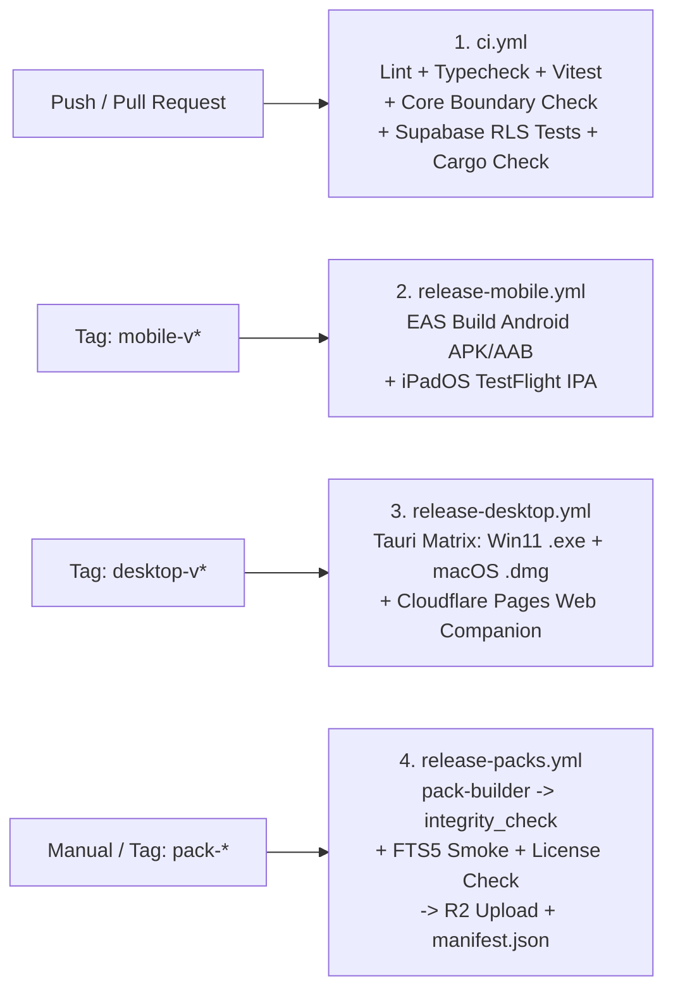

# E2: CI/CD Pipeline & Pack Release Spec

**Document ID:** `E2`  
**Version:** `1.0.0`  
**Status:** `Approved`  
**Owner:** Founder / DevOps  
**Last Updated:** `2026-11-24`  
**Related Docs:** `B3`, `B4`, `B5`, `E1`, `F1`

## Purpose & Scope

Specifies the automated GitHub Actions pipelines for continuous quality checks, Android/iPadOS builds (EAS), Windows 11/macOS desktop installers (Tauri), Web Companion deploys, and atomic Cloudflare R2 content pack releases.

## Audience

Founder and AI coding partner authoring `.github/workflows/*.yml`.

## Body

### 4.1 Four Lean GitHub Actions Workflows (Free-Tier Friendly)

| Workflow File | Trigger | Exact Jobs & Quality Gates | Artifacts / Target |
| --- | --- | --- | --- |
| `.github/workflows/ci.yml` | PR & push to `main` | 1. `pnpm turbo lint typecheck test` 2. ESLint enforces zero `react-native`/`@tauri-apps`/`window` imports in `packages/core` 3. `supabase start && supabase db reset` + SQL RLS test suite (`F1`) 4. `cargo check --manifest-path apps/desktop/src-tauri/Cargo.toml` | Green PR check gate |
| `.github/workflows/release-mobile.yml` | Git tag `mobile-v*` | 1. Run `ci.yml` checks 2. `eas build --platform android --profile preview` (direct APK) & `production` (Play Internal) 3. `eas build --platform ios --profile production` (iPadOS + iOS TestFlight) | Signed `.apk`, `.aab`, TestFlight IPA |
| `.github/workflows/release-desktop.yml` | Git tag `desktop-v*` | 1. Matrix `windows-latest` & `macos-latest` (`tauri-apps/tauri-action`) 2. Build Web Companion (`VITE_TARGET=web pnpm --filter desktop build`) → deploy to Cloudflare Pages | Signed `.msi`/`.exe`, `.dmg`, GitHub Release, Web URL |
| `.github/workflows/release-packs.yml` | `workflow_dispatch` (`pack_id`, `version`) | 1. Run `tools/pack-builder` 2. Assert `PRAGMA integrity_check = ok`, FTS5 query <50ms, non-empty `pack_metadata.license_spdx` & `attribution_text` (`B5`) 3. Gzip + compute compressed & uncompressed SHA-256 4. Upload immutable `<packId>-<ver>.sqlite.gz` to R2 **before** atomically overwriting `manifest.json` | R2 bucket + GitHub Release mirror |

### 4.2 Versioning & Rollback Rules

- **App Binaries:** SemVer (`0.1.0` Phase 1 MVP → `1.0.0` Phase 4 v1 launch).
- **Content Packs:** Independent SemVer (`core_bsb-1.0.0.sqlite.gz`) + integer `schemaVersion` (`1`). Old `.sqlite.gz` files are **never deleted** from R2, enabling instant zero-downtime rollback by republishing the previous `manifest.json` (`E4` RB-01).
- **Supabase Migrations:** Forward-only numbered SQL files in `supabase/migrations/`; tested against `staging` before `supabase db push` to `prod`.

## Acceptance / Done Criteria

- `ci.yml` completes in <5 minutes on GitHub-hosted runners.
- `release-packs.yml` refuses to upload `manifest.json` if any pack fails `PRAGMA integrity_check` or lacks license metadata.

## Open Questions

- `[OPEN]` Decide whether macOS `.dmg` notarization (requires $99/yr Apple Developer Program—also needed for iPadOS TestFlight) is active from Day 1 or personal Xcode signing for Phase 1.

## Assumptions

- `[ASSUMPTION]` Solo developer holds or plans to hold an Apple Developer account for iPadOS TestFlight distribution (`SPEC §1.1`).

## Change Log

- `1.0.0` | `2026-11-24` | Athena | Defined 4 lean GitHub Actions workflows, atomic R2 pack publishing order, and migration/rollback rules.

## Traceability

- Upstream: `B3`, `B4`, `B5`, `E1`. Downstream: `E4`, `F1`, `G4`.
